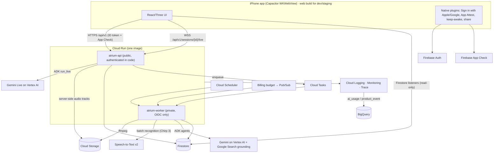

# Atrium — architecture

Atrium is an AI coaching app for iPhone. The first module is **interview preparation**:
an agent researches the company and role to predict the likely interview journey, a
live voice interviewer runs each round, and an asynchronous evaluator turns the
recording into timestamped, actionable feedback and competency progress. The second,
**oral exam preparation**, takes whatever material a student's course handed out, works
out from it what the exam covers and how it is run, and examines them on it.

The code is a **modular platform**: identity, consent, storage, media, transcripts,
AI access, live conversation, background jobs, feedback, competencies, quotas,
deletion and observability are shared; the interview and oral exam modules plug into
them. Future modules (sales, leadership, …) add a module, not a new platform.

Detailed guides: [setup](docs/setup.md) · [cloud](docs/cloud.md) · [data](docs/data.md) ·
[API](docs/api.md) · [agents & pipeline](docs/agents-and-pipeline.md) ·
[operations](docs/operations.md) · [security & privacy](docs/security-privacy.md)

---

## 1. Where this started

A frontend-only prototype: React 18 + React Three Fiber + zustand + Tailwind + Vite,
installable as a PWA. A 3D city led to a company building, a practice setup form and a
video-call or meeting-room screen. There was no backend, sign-in, database, AI,
recording, tests or version control. Interview "types" were a fixed list of six that
only changed a label.

What was kept: the 3D city and interiors, the call and meeting screens, the design
system (`src/index.css`, `ui/Button`, `ui/Icon`), and the navigation state machine.

What changed: the interview setup (company, role, job description, resume → an
agent-built, editable journey instead of the fixed list), the call screen (a real live
interviewer), a feedback dashboard, an account sheet, and everything behind them.

## 2. Target architecture

One container image serves two Cloud Run services (`ROLE=api|worker`). They are
separate because their exposure (public vs private), timeouts (60-minute WebSockets vs
30-minute tasks) and scaling differ — not to create microservices.

## 3. Components

| Area | Where | Responsibility |
|---|---|---|
| App shell & 3D | `src/three`, `src/components` | City, interiors, call, setup panels (existing, preserved) |
| App platform | `src/platform` | Firebase init, API client, App Check bridge, native bridge, live protocol & client, audio capture/playback |
| Interview UI | `src/modules/interview` | Journey review, live interview hook, feedback dashboard, API types |
| Oral exam UI | `src/modules/exam`, `src/components/navigation/OralExam.tsx` | Minimal setup (subject plus materials), the analysis taking shape, the examiner's room and the board |
| API/worker core | `backend/app/core` | Settings with environment guard, JSON logging with redaction, errors, middleware, tracing |
| Platform services | `backend/app/platform` | Auth, users/consent, plans/usage, rate limits, storage, media tracks, transcripts, AI gateway, live gateway, jobs/pipeline, feedback validation, competencies, deletion |
| Interview module | `backend/app/modules/interview` | Catalogs, Agent 1 (strategist), Agent 2 (live interviewer, evaluator), retry planner, resumes, applications/blueprints, sessions |
| Oral exam module | `backend/app/modules/exam` | Material reading, the analyst (knowledge map and exam style), the live examiner, the exam evaluator, courses/materials/analyses, sessions |
| Security rules | `firebase/` | Firestore and Storage rules, indexes, rules tests |
| Infrastructure | `infra/` | Project bootstrap, Terraform module + dev/staging/prod |
| CI/CD | `.github/workflows` | CI, deploy (staging → approval → prod), iOS build/TestFlight |

## 4. Module boundary

`backend/app/modules/registry.py` defines `ModuleDescriptor`: a module contributes
routers (`/api/v1/<module>/…`), services looked up by name, background task handlers
and deletion hooks. `backend/app/wiring.py` is the only place listing installed modules.

Services the platform asks a module for:

| Service | Used by | Interview implementation |
|---|---|---|
| `live_agent_factory` | live gateway | builds the interviewer's instruction from the round |
| `evaluator` | pipeline | Agent 2b evaluation |
| `retry_planner` | pipeline | weakest competencies → next attempt's targets |
| `competency_name` | feedback & progress APIs | catalog names |
| `tasks` | module task route | resume extraction, blueprint generation |

Platform sessions are generic (`module`, `status`, `processingStatus`, `media`,
`summary`); module-specific data lives in `session.context`. Communication
competencies (`comm.*`) and the global communication profile belong to the platform.

## 5. Main flows

**Interview journey.** Setup form → `POST /interview/applications` → `POST
…/blueprints:generate` (quota, consent, kill switch) → Cloud Task → Agent 1 research
(Google Search) → blueprint (structured output) → validation → Firestore. Progress streams into the blueprint document as the agent
works (queries, sources, notes, each round as it is written), and the app listens live and shows "Your likely interview journey" → user edits (new version) → picks a
round → `POST /interview/sessions`.

**Live interview.** The app opens a WebSocket and authenticates in the first message.
The gateway checks ownership, consent, verified email, kill switch and live-minute
quota, takes a one-per-user lock, and connects Gemini Live through ADK. Audio flows
both ways; the gateway records both voices as timestamped track segments, writes a
turn log, enforces time/idle/quota limits and persists resumable state. Dropped
connections resume (Live session-resumption handle, frame replay de-duplicated by
sequence number). On a real end it marks the session ended and enqueues processing
once. If the camera is on, the app records it (video only) and uploads it afterwards in
resumable chunks directly to Cloud Storage; the worker makes it streamable, and the
feedback player keeps it in sync with the audio timeline.

**Processing.** Three idempotent Cloud Tasks steps on the worker: rebuild audio and
start Chirp 3 recognition → poll until done and assemble the transcript → compute
delivery metrics, run the evaluator, validate, persist feedback events, update the
competency profile, plan retry targets. Each step claims the job transactionally, so
duplicates and late deliveries do nothing. See [agents & pipeline](docs/agents-and-pipeline.md).

**Oral exam.** Setup asks two things: what the student is preparing for, and their
materials (files, a link or pasted text) → `POST /exam/courses` and
`…/materials` → each file is read into text on the worker → `POST
…/analyses:generate` → the analyst classifies every material and builds the knowledge
map, looking up the exam format on the web only when the material didn't say → the app
asks the one question that is still open (how the exam runs), and only then → `POST
/exam/sessions`. The exam itself is a live session like any other: the examiner across a
desk, or the board split-screen, with the board's snapshots going to the examiner as the
student writes. Feedback and sitting it again follow the same pipeline as an interview.

**Retry.** `POST /interview/sessions/{id}/retry` creates the next attempt with the
retry plan: the interviewer tests the same competencies with new questions, and the
next evaluation reports deltas ("+18 answer structure").

**Account deletion.** `DELETE /me` (recent sign-in) → disable and revoke → delete
objects, Firestore subtree, jobs, live state → delete the Firebase user → tombstone →
two later sweeps. See [data](docs/data.md#account-deletion).

## 6. Agents (summary)

| Agent | Runs | Input | Output | Model |
|---|---|---|---|---|
| Resume profile | worker | extracted resume text | `ResumeProfile` | `gemini-3.8-flash` |
| **Agent 1** research | worker | company, role, location, JD | notes + grounding sources | `gemini-3.8-flash` + Google Search |
| **Agent 1** blueprint | worker | application, resume profile, research, catalogs | `BlueprintDraft` → validated | `gemini-3.8-flash` |
| **Agent 2a** interviewer | api (live) | round plan, resume/role focus, retry targets | real-time voice | `gemini-live-2.5-flash-native-audio` |
| **Agent 2b** evaluator | worker | transcript segments, metrics, round, rubric | `EvaluationDraft` → validated | `gemini-3.8-flash` |
| Exam analyst | worker | the student's materials (text and images) | `KnowledgeMapDraft` → validated | `gemini-3.8-flash` (+ Google Search when the exam format is unclear) |
| Exam examiner | api (live) | knowledge map, exam style, retry targets | real-time voice | `gemini-live-2.5-flash-native-audio` |
| Retry planner | worker | scores, question classification | retry targets | deterministic (no model) |

Models and limits are configuration (`TEXT_MODEL`, `LIVE_MODEL`, `platform/ai/gateway.py`).

## 7. Data, storage and API

- Firestore is user-rooted (`users/{uid}/…`); clients only read their own documents,
  every write goes through the API. Server-only collections: `jobs`, `liveSessions`,
  `liveLocks`, `rateLimits`, `config`, `deletions`. Full schema: [data](docs/data.md).
- Cloud Storage: one private bucket for user content, one for 3-day processing files;
  no client access; signed links only. Layout: [data](docs/data.md#cloud-storage).
- API: versioned `/api/v1`, RFC 9457 problem details, Pydantic validation, per-route
  size limits, rate limits and quotas. Reference: [API](docs/api.md).

## 8. Authentication and App Check

Firebase Auth (Sign in with Apple and Google natively on iOS; email/password with
verification). The API verifies ID tokens with the Admin SDK (revocation checked on
sensitive routes) and derives the uid only from the token; every ID in a path or body
is resolved under that uid. App Check: App Attest on iOS (native plugin), tokens sent
to the API and wired into the Firebase JS SDK; enforced on the API and Firestore in
staging and production.

## 9. Environments and deployment

Three projects — `atrium-coach-dev`, `atrium-coach-staging`, `atrium-coach-prod` —
each with its own Firebase project, buckets, service accounts, secrets and Terraform
state. The backend refuses to start when its environment and project don't match
(e.g. dev code pointed at a prod project). Local development uses emulators and a fake
AI provider. Deployment: [operations](docs/operations.md).

## 10. Security model (summary)

Least-privilege service accounts per environment; keyless CI (Workload Identity
Federation); private buckets with public access prevention; signed URLs; deny-by-default
rules with tests; content-based file validation; prompt-injection hardening (sanitized,
fenced untrusted text, no side-effecting tools on agents reading it, schema validation);
redacted logs with hashed user IDs; rate limits, quotas, live-session caps and a
budget-driven AI kill switch. Details: [security & privacy](docs/security-privacy.md).

## 11. Observability

Structured JSON logs (request, session, job, step IDs and a hashed user ID) correlated
with Cloud Trace; log-based metrics and alerts for AI, pipeline and live failures;
5xx, CPU and queue-backlog alerts; an uptime check; `ai_usage` and `product_event`
exported to BigQuery. Details: [operations](docs/operations.md#monitoring).

## 12. CI/CD

`ci.yml` on every change (web build/tests, backend lint/types/unit/integration with
emulators, rules tests, Terraform validation, image build). `deploy.yml` on `main`:
build once → staging (Terraform, rules, services, smoke tests) → manual approval →
the same image to production. `ios.yml`: simulator compile; TestFlight once Apple
signing is configured.

## 13. Decisions and trade-offs

| Decision | Why | Trade-off |
|---|---|---|
| Capacitor around the existing app | Preserves the 3D experience and design | WebView audio needs care; native plugins for auth and App Attest |
| Gemini Live proxied through Cloud Run | Server-owned prompts, tools, limits and recording; no Vertex ephemeral tokens | Extra hop; 60-minute WebSocket limit handled with reconnect/resume |
| Server-side voice tracks | Exact timing, no dependency on a large phone upload for feedback | Gateway writes segments during the call |
| Chirp 3 for transcripts, Gemini for judgement | Word timestamps are measured, not generated | Batch recognition can take minutes; 15-minute chunks |
| Deterministic delivery metrics and retry planning | Accurate, cheap, testable | Less nuance than a model for prosody |
| Half-duplex mic without headphones | Stops the interviewer hearing itself on a phone speaker | Candidate taps Interrupt to cut in |
| Firestore user-rooted, server-only writes | Simple rules, IDOR-resistant, recursive deletion | Writes need the API |
| Validation + one repair retry for AI output | Structured, bounded, reviewable failures | Occasional failed generation to retry |
| Two Cloud Run services from one image | Different exposure/timeouts without microservices | Two deploys per release |
| A different, more senior interviewer per round | A loop that escalates — recruiter, engineers, hiring manager, executive — is what candidates are actually preparing for | Voice pairings are listening judgements: Google documents Live voices by character, never by gender |

## 14. Status

**Implemented and verified locally** (unit, integration against emulators, rules tests):
environment guard, auth and App Check checks, consent, quotas, rate limits, resumes,
applications, Agent 1 with validation and editing, live gateway with recording and
resume, processing pipeline with feedback validation, competency profile and deltas,
retry flow, signed media links, camera video upload/remux with synced playback, shared
code/notes editor, estimated AI cost per user, feedback dashboard, account deletion,
retention, reconciler, progress endpoints.

**Verified against real Google APIs in dev:** Gemini evaluator with schema validation,
Gemini Live via ADK (audio, transcription, resumption handle), Chirp 3 batch
recognition with word timestamps.

**Provisioned:** `atrium-coach-dev` (Terraform), with staging and production created
from the same module.

**Remaining before App Store submission:** see [operations — launch checklist](docs/operations.md#launch-checklist).
